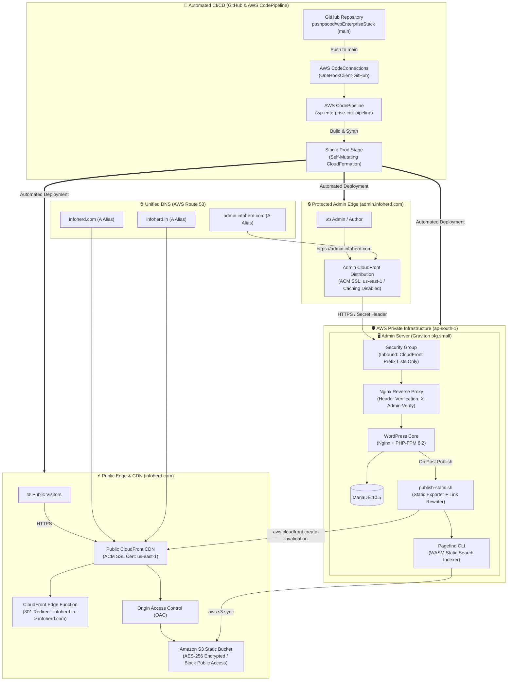

# WordPress Enterprise Stack - 100% Native AWS Architecture (infoherd.com)

## 📋 Table of Contents
1. [Executive Overview](#executive-overview)
2. [Domain Architecture & Redirection](#domain-architecture--redirection)
3. [Admin Security (admin.infoherd.com)](#admin-security-admininfoherdcom)
4. [System Architecture Diagram](#system-architecture-diagram)
5. [Publishing Flow & Automation](#publishing-flow--automation)
6. [Search Implementation (Pagefind)](#search-implementation-pagefind)
7. [Cost Analysis](#cost-analysis)

---

## Executive Overview

This architecture implements a high-performance, single-provider **Static WordPress ("Bake & Serve")** platform tailored for **infoherd.com** and **infoherd.in** managed entirely within **AWS Route 53**:
- **Primary Public Website (`https://infoherd.com`):** Served globally via **Amazon CloudFront** backed by a private, encrypted **Amazon S3** static bucket.
- **Brand Protection & 301 Redirects (`infoherd.in` & `www.*`):** A lightweight CloudFront edge function automatically issues permanent 301 redirects to `https://infoherd.com`, preserving SEO equity and domain authority.
- **Admin Portal (`https://admin.infoherd.com`):** Secured by an AWS CloudFront distribution proxying to the isolated Graviton EC2 instance. The EC2 Security Group is restricted **strictly to AWS CloudFront Managed Prefix List** (`pl-9aa247f3`). General internet access to EC2 is 100% blocked.
- **Verification Header:** CloudFront injects a secret `X-Admin-Verify` token. Nginx rejects any direct or mismatched requests with `403 Forbidden`.
- **Zero Third-Party Dependencies:** 100% AWS Route 53, ACM SSL, CloudFront, S3, and EC2. No Cloudflare setup or nameserver migrations required.
- **Automated Backup & Disaster Recovery:** 
  - Dual-layer backup with AWS Data Lifecycle Manager (DLM) daily block-level snapshots (7-day retention).
  - Automated continuous MariaDB & media backups synced to S3 on publish and nightly via cron.
  - Automatic boot-time database and media restore if the EC2 instance is replaced or corrupted.
  - CloudWatch auto-recovery alarm (`StatusCheckFailed_System`) for automated physical host failure recovery.
- **Monthly Cost:** **~$14 – $18/month** (Customer KMS fee eliminated by using default AWS-managed encryption, ALB, WAF, and NAT gateways eliminated).

---

## Domain Architecture & Redirection

```
   User types:
   • infoherd.in
   • www.infoherd.in       ───▶ [ CloudFront Edge Function ] ──▶ 301 Redirect to https://infoherd.com
   • www.infoherd.com

   User types:
   • infoherd.com          ───▶ [ Public CloudFront CDN ] ─────▶ Serves Static HTML from S3 (< 50ms)

   Admin types:
   • admin.infoherd.com    ───▶ [ Admin CloudFront CDN ] ──────▶ Injects Secret Header ──▶ EC2 (Prefix List)
```

---

## System Architecture Diagram



---

## Cost Analysis

| Component | Specification | Estimated Monthly Cost |
| :--- | :--- | :--- |
| **Admin EC2** | 1x `t4g.small` (Graviton ARM, 2GB RAM) | **$12.26** (drops to ~$7.59 with 1-Yr Savings Plan) |
| **Public IPv4** | AWS IPv4 address for CloudFront origin routing | **$3.65** |
| **Route 53 DNS** | 2 zones (`infoherd.com`, `infoherd.in`) | **$1.00** |
| **Admin Security Group** | Inbound restricted to CloudFront Prefix List (No ALB, No NAT) | **$0.00** |
| **EBS Storage** | 20GB gp3 encrypted root volume (AWS-managed key) | **$1.76** |
| **KMS Encryption** | AWS-managed default key (`alias/aws/ebs`) | **$0.00** |
| **Automated Backups** | AWS DLM snapshots (7-day retention) + S3 DB/uploads | **~$0.25** |
| **Public S3** | Static HTML, CSS, media + backups | **~$0.05** |
| **CloudFront** | 2 Distributions (Always-Free Tier: 1TB + 10M requests) | **$0.00** |
| **ACM SSL Certificates** | 2 Multi-domain & Admin certs (`us-east-1`) | **$0.00** |
| **TOTAL** | | **~$18.97 / month** (~$14.30 with Savings Plan) |
