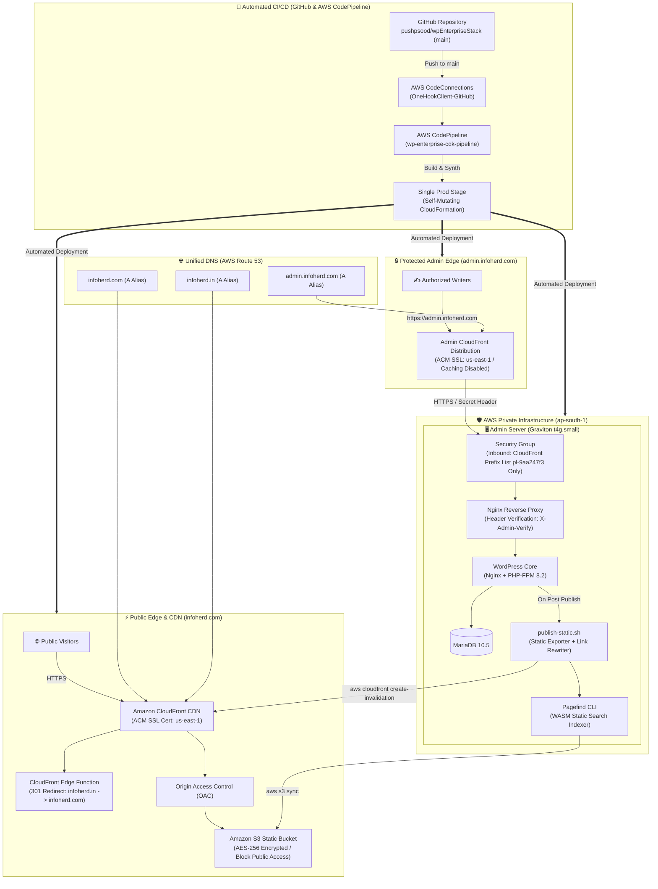

# WordPress Enterprise Stack - 100% Native AWS Architecture

Production-ready, highly secure, and ultra-low latency **Static WordPress ("Bake & Serve")** infrastructure on AWS configured for **infoherd.com** and **infoherd.in**.

Combines the familiar editing power of **WordPress** on **admin.infoherd.com** (secured via AWS CloudFront with Managed Prefix List filtering and secret header verification) with a **100% stateless public edge on infoherd.com (S3 + CloudFront)** and **Pagefind WASM search**.

---

## Architecture Summary

- **`https://infoherd.com`**: Primary public website. Ultra-low latency (< 50ms TTFB) served by CloudFront from private S3 with Origin Access Control.
- **`infoherd.in` & `www.*`**: Automatically 301-redirected to `https://infoherd.com` at the CloudFront edge via edge function.
- **`https://admin.infoherd.com`**: Editorial portal. Direct public internet access is 100% blocked at the security group level. Inbound traffic is strictly restricted to AWS CloudFront's Managed Prefix List (`pl-9aa247f3`) with custom `X-Admin-Verify` token inspection.
- **100% Unified in AWS Route 53**: No external DNS providers or third-party tunnels required.
- **Monthly Cost:** **~$15 – $18/month** (ALB, WAF, and NAT gateways eliminated).

---

## Architecture Highlights

1. **Static Baking Pipeline:** When an author creates or updates posts in WordPress, `/var/www/scripts/publish-static.sh` renders the site into static HTML/CSS/JS, runs Pagefind WASM indexing, rewrites internal `admin.infoherd.com` URLs to `infoherd.com`, syncs to S3, and invalidates CloudFront.
2. **AWS Systems Manager (SSM):** Fully managed, browser-based secure shell access into the EC2 instance with zero open SSH ports (port 22 closed, no keypairs required).
3. **Self-Mutating CI/CD Pipeline:** Commits to `main` automatically trigger AWS CodePipeline to build, synth, self-mutate, and deploy all infrastructure stacks across `us-east-1` (ACM) and `ap-south-1` (App & EC2).

---

## License

MIT
